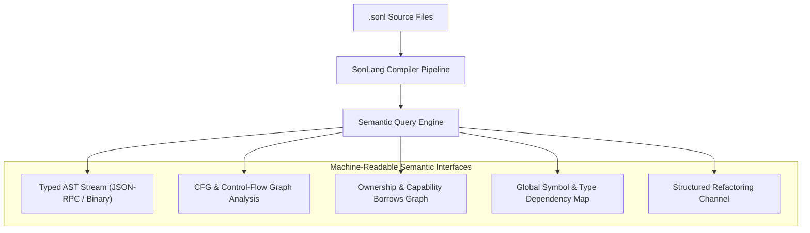

# SonLang AI-Native Semantic Interface Protocol

## 1. Vision and Motivation

Traditional programming languages and compilers treat developer tooling as an afterthought, relying on regex-based text search, brittle external linters, or fragile Language Server Protocol (LSP) hacks.

SonLang is designed from the ground up to be **AI-Native**. The compiler contains a first-class, high-performance semantic introspection engine that outputs rich, structured representations of code semantics directly to AI agents, formal verification tools, and IDEs.

---

## 2. Protocol Architectural Layers



---

## 3. Core Protocol Capabilities

### 3.1 Structural AST & Symbol Query
The compiler provides sub-millisecond querying of any symbol or expression in a workspace:
- Exact declaration provenance.
- Inferred types and contract resolutions.
- Full call graph and reverse call hierarchy.

### 3.2 Ownership & Capability Verification Graph
For every variable and allocation, the AI semantic interface can query the live borrow state:
```json
{
  "symbol": "buffer",
  "declaration_span": { "line": 14, "col": 5 },
  "capability": "exclusive_borrow",
  "active_borrows": [
    {
      "borrower": "slice_view",
      "kind": "shared",
      "acquired_at": { "line": 18, "col": 12 },
      "expires_at": { "line": 26, "col": 5 }
    }
  ],
  "is_moveable": false,
  "reason": "Outstanding shared borrow by `slice_view`"
}
```

### 3.3 Semantic-Aware Code Mutation & Refactoring
Instead of requesting AI agents to emit raw text diffs (which frequently suffer from whitespace errors or missing braces), the protocol supports **Structural Code Edits**:
- Replace AST node with validated expression.
- Safe rename with cross-module semantic propagation.
- Automated contract implementation scaffolding.
