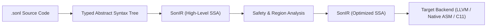

# SonIR: Intermediate Representation Specification

## 1. Overview and Purpose

**SonIR** is SonLang's native intermediate representation. It forms the semantic backbone between the frontend type-checking/ownership engine and target backend code generation.

Unlike generic low-level IRs (such as raw LLVM IR or C), SonIR explicitly preserves:
- High-level type invariants and algebraic variants.
- Ownership, borrow, and region capability semantics.
- AI-inspectable semantic metadata and provenance tracking.



---

## 2. SonIR Architecture

SonIR is structured as a control-flow graph (CFG) of basic blocks in Static Single Assignment (SSA) form.

### 2.1 Modules and Functions
- A **Module** contains global symbols, user types, and function definitions.
- A **Function** consists of:
  - Input parameters with explicit capability types.
  - Return type.
  - An entry basic block.
  - A collection of connected basic blocks.

### 2.2 Basic Blocks
A basic block consists of:
1. An identifier label (`bb0`, `bb1`, ...).
2. A sequential list of SSA instructions.
3. A single terminator instruction (`jump`, `branch`, `match_branch`, `return`).

---

## 3. SonIR Core Instruction Set

### 3.1 Memory and Ownership Instructions
- `alloca %dst, <Type>, [Region]`: Allocate memory on stack or within specified region.
- `load %dst, %src`: Load value from memory location.
- `store %val, %dst`: Store value into memory location.
- `move %dst, %src`: Transfer ownership of resource from `%src` to `%dst`. Marks `%src` as consumed.
- `borrow %dst, %src, <shared|exclusive>`: Create a capability-checked reference.
- `drop %src`: Deterministically invoke the drop destructor for `%src`.

### 3.2 Arithmetic & Logical Instructions
- `add %dst, %lhs, %rhs`
- `sub %dst, %lhs, %rhs`
- `mul %dst, %lhs, %rhs`
- `div %dst, %lhs, %rhs`
- `rem %dst, %lhs, %rhs`
- `and %dst, %lhs, %rhs`
- `or %dst, %lhs, %rhs`
- `xor %dst, %lhs, %rhs`
- `shl %dst, %lhs, %rhs`
- `shr %dst, %lhs, %rhs`
- `cmp <eq|ne|lt|le|gt|ge> %dst, %lhs, %rhs`

### 3.3 Control Flow Terminators
- `jump <block_label>`: Unconditional branch.
- `branch %cond, <true_block>, <false_block>`: Conditional branch.
- `match_branch %variant, [ <tag0>: <block0>, <tag1>: <block1>, default: <blockN> ]`: Multi-way tagged union branch.
- `call %dst, <func_symbol>(%arg0, %arg1, ...)`: Function invocation.
- `return %val`: Return from function.

---

## 4. Textual Representation Example

Below is the SonIR representation of a factorial function:

```sonir
func @factorial(%n: i64) -> i64 {
bb0:
    %cmp = cmp le %n, 1:i64
    branch %cmp, bb1, bb2

bb1: // Base case
    return 1:i64

bb2: // Recursive case
    %sub = sub %n, 1:i64
    %rec = call @factorial(%sub)
    %res = mul %n, %rec
    return %res
}
```
