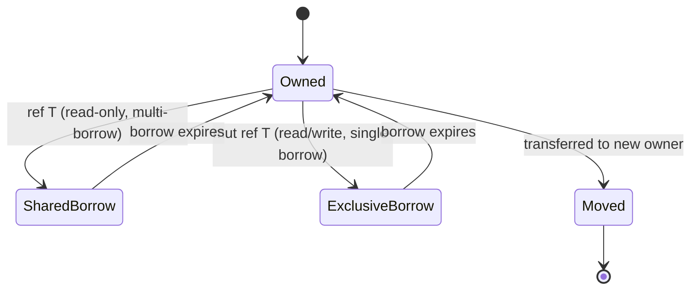

# SonLang Memory Model & Ownership Specification

## 1. Core Philosophy: Deterministic Safety without Garbage Collection

SonLang achieves memory safety, thread safety, and predictable real-time performance without relying on a tracing garbage collector or mandatory reference counting.

Its model combines:
1. **Affine / Linear Resource Ownership**: Every resource has a single designated owner at any given instant.
2. **Capability-Tracked Borrowing**: Aliasing is governed by exclusive mutable access vs. shared immutable access.
3. **Region / Arena Capabilities**: First-class support for lexically scoped or explicit memory regions for ultra-high throughput batch allocation.
4. **Explicit Allocator Interfaces**: Standard library and runtime primitives accept custom memory allocators.

---

## 2. Ownership and Move Semantics

### 2.1 Single Owner Invariant
Every dynamically allocated object or resource handle (e.g., file descriptors, sockets, heap buffers) has exactly one owner variable.

```son
val original_buffer: Buffer = Buffer::allocate(1024);
val transferred_buffer: Buffer = original_buffer; // original_buffer is MOVED

// Accessing original_buffer after this line is a compile-time error:
// error: use of moved value `original_buffer`
```

### 2.2 Deterministic Cleanup (Drop)
When an owned value reaches the end of its lexical scope, its destructor is automatically called:
- Memory is immediately reclaimed.
- Operating system handles are closed.
- Execution order is deterministic and strictly reverse-lexical.

---

## 3. Borrowing & Reference Capabilities

To allow safe access without transferring ownership, SonLang supports borrowing governed by compiler capability analysis:



### Invariants:
1. **Aliasing XOR Mutability**: At any instant in time, data may have:
   - Arbitrary number of active immutable references (`ref T`), **OR**
   - Exactly one exclusive mutable reference (`mut ref T`).
2. **No Dangling References**: The compiler statically ensures that no borrowed reference survives longer than the owner it references.

---

## 4. Region-Based Memory Management

For performance-critical systems workloads (game loops, compiler passes, network packet processing), allocating individual objects on a general-purpose heap causes fragmentation and cache overhead.

SonLang introduces first-class **Regions**:

```son
region frame_arena {
    // All allocations within this block use the frame_arena allocator
    val ast_node = alloc[frame_arena] AstNode::new();
    val token_list = alloc[frame_arena] List[Token]::new();
    
    process_frame(ref ast_node);
} 
// The entire frame_arena is deallocated in O(1) at the end of the region block.
// No individual object deallocation overhead.
```

References pointing to objects inside a region cannot escape the lifetime of that region:
```son
var escaped_ref: ref AstNode = null;
region local_region {
    val node = alloc[local_region] AstNode::new();
    // escaped_ref = ref node; // COMPILE ERROR: reference outlives region capability
}
```

---

## 5. Explicit Unsafe Boundary

Low-level systems code (operating system kernels, hardware drivers, memory allocators, foreign function interfaces) occasionally requires bypassing static compiler checks.

SonLang confines these operations strictly within explicit `unsafe` blocks:
- Raw pointer dereferencing (`*const T`, `*mut T`).
- Direct inline assembly.
- Foreign function calls (C ABI).
- Reinterpreting raw memory bytes.

Any code outside of an `unsafe` block is mathematically guaranteed by the compiler to be free of data races, use-after-free, double-free, and dangling pointer dereferences.
